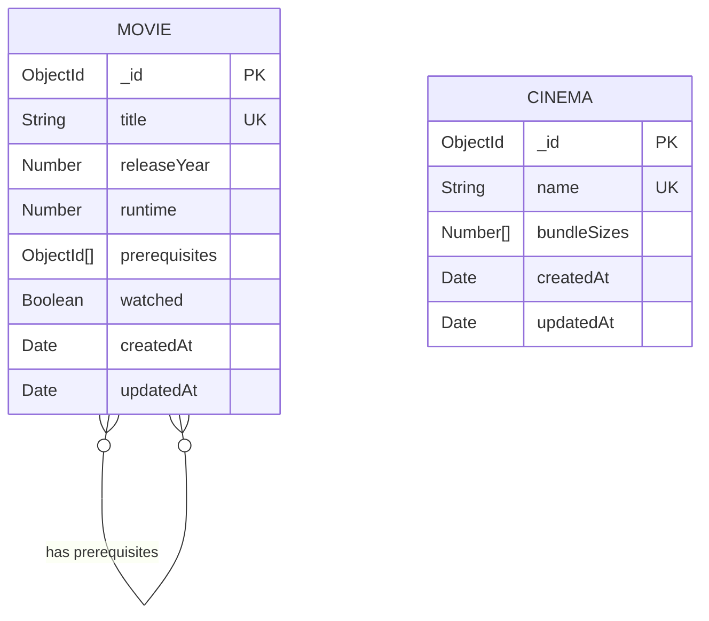

# Doomsday Ready

A full-stack movie planning application that helps users manage movies, track prerequisite viewing progress and calculate optimal cinema ticket bundle combinations for group bookings.

## Features

### Movie Management
- Add movies with title, release year and runtime.
- Define prerequisite movies for each movie.
- Edit movie prerequisites.
- Mark movies as watched or unwatched.
- View all movies with their details.

### Rewatch Plan
- Select a target movie.
- Generate an ordered list of prerequisite movies.
- Automatically arrange movies based on their dependencies.
- Track watched movies and viewing progress.
- Calculate remaining watch time.

### Cinema Booking
- View available cinemas.
- Select a cinema and enter group size.
- Calculate the optimal ticket bundle combination.
- Minimize the number of bundles required.
- Display when an exact booking combination is not possible.

## Technology Stack

### Frontend
- React 19
- Vite
- JavaScript
- Tailwind CSS 4
- shadcn/ui
- React Router

### Backend
- Node.js
- Express 5
- MongoDB
- Mongoose
- Zod

### DevOps
- Docker
- Docker Compose
- Nginx

## Project Structure

```text
doomsday-ready/
├── backend/
│   ├── src/
│   │   ├── algorithms/
│   │   ├── config/
│   │   ├── controllers/
│   │   ├── middleware/
│   │   ├── models/
│   │   ├── routes/
│   │   ├── services/
│   │   ├── validations/
│   │   └── server.js
│   ├── .dockerignore
│   ├── .env.example
│   ├── Dockerfile
│   └── package.json
│
├── frontend/
│   ├── public/
│   ├── src/
│   │   ├── components/
│   │   ├── lib/
│   │   ├── pages/
│   │   ├── services/
│   │   ├── App.jsx
│   │   └── main.jsx
│   ├── .dockerignore
│   ├── .env.example
│   ├── Dockerfile
│   ├── nginx.conf
│   └── package.json
│
├── docker-compose.yml
├── .gitignore
└── README.md
```

## Installation and Setup

### Prerequisites

- Node.js (LTS recommended)
- npm
- MongoDB database (local or MongoDB Atlas)
- Git

### 1. Clone the Repository

```bash
git clone https://github.com/amlan564/doomsday-ready.git
cd doomsday-ready
```

### 2. Backend Setup

```bash
cd backend
npm install
```

Create a `.env` file inside the `backend` directory using `.env.example` as a reference.

Configure the environment variables:

```env
PORT=5000
MONGODB_URI=your_mongodb_connection_string
```

Start the backend development server:

```bash
npm run dev
```

The backend will run at:

`http://localhost:5000`

### 3. Frontend Setup

Open a new terminal from the project root:

```bash
cd frontend
npm install
```

Create a `.env` file inside the `frontend` directory using `.env.example` as a reference.

Configure the environment variable:

```env
VITE_API_URL=http://localhost:5000/api
```

Start the frontend development server:

```bash
npm run dev
```

Vite will display the local development URL in the terminal.

## Docker Setup

### Prerequisites

- Docker Desktop
- MongoDB Atlas account and connection string

### 1. Configure Environment Variables

Create a `backend/.env` file using `backend/.env.example` as a reference.

Configure your MongoDB Atlas connection string:

```env
PORT=5000
MONGODB_URI=your_mongodb_connection_string
```

Make sure your MongoDB Atlas Network Access settings allow connections from your environment.

### 2. Build and Start the Application

From the project root, run:

```bash
docker compose up --build -d
```

Docker Compose builds the backend and frontend images and starts both containers.

### 3. Access the Application

- Frontend: http://localhost:3000
- Backend API: http://localhost:5000/api
- Health Check: http://localhost:5000/api/health

### 4. Stop the Application

```bash
docker compose down
```

### Docker Architecture

- The backend runs in a Node.js container.
- The frontend is built using Vite and served through Nginx.
- Docker Compose manages both application containers.
- MongoDB Atlas is used as the database.

**Note:** Environment files containing credentials are excluded from Git. Never commit `.env` files or expose database credentials.

## API Documentation

Base URL:

`http://localhost:5000/api`

### Health Check

| Method | Endpoint | Description |
|---|---|---|
| GET | `/health` | Check API status |

### Movie Endpoints

| Method | Endpoint | Description |
|---|---|---|
| POST | `/movies` | Create a movie |
| GET | `/movies` | Retrieve all movies |
| PATCH | `/movies/:id` | Update movie information |
| GET | `/movies/:id/rewatch-order` | Generate prerequisite viewing order |

### Cinema Endpoints

| Method | Endpoint | Description |
|---|---|---|
| POST | `/cinemas` | Create a cinema |
| GET | `/cinemas` | Retrieve all cinemas |
| GET | `/cinemas/:id/booking?groupSize=6` | Generate booking quote |

## Core Algorithms

### Rewatch Order Algorithm

Uses Depth-First Search (DFS) to traverse movie prerequisites and generate a valid viewing order.

- Ensures prerequisites are placed before dependent movies.
- Prevents duplicate movies in the generated order.
- Detects circular dependencies.
- Calculates watched progress and remaining runtime.

### Cinema Booking Algorithm

Uses Dynamic Programming to find the minimum number of ticket bundles required for an exact group size.

- Evaluates available bundle sizes.
- Finds the optimal bundle combination.
- Returns an impossible result when an exact combination cannot be formed.

## Data Model

The application uses two MongoDB collections: `Movie` and `Cinema`.



- A Movie can reference multiple prerequisite Movies through ObjectId references to the same collection.
- A Cinema stores its available ticket bundle sizes as an array of numbers.
- Both models include automatic creation and update timestamps.

## AI Tool Usage

ChatGPT was used as an AI assistance tool during development.

Its assistance included:

- Discussing application architecture and implementation approaches.
- Reviewing code structure and helping troubleshoot issues.
- Supporting algorithm implementation and validation.
- Assisting with frontend component development and UI improvements.
- Helping prepare project documentation and setup instructions.

All generated suggestions and code were reviewed, adapted, and tested during implementation.

## License

This project was developed as part of a Full-Stack Developer Internship Challenge.